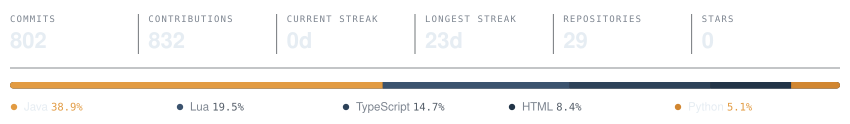

<picture>
  <source media="(prefers-color-scheme: dark)" srcset="https://raw.githubusercontent.com/Fiwpr06/Fiwpr06/output/horizon-line-dark.svg" />
  <source media="(prefers-color-scheme: light)" srcset="https://raw.githubusercontent.com/Fiwpr06/Fiwpr06/output/horizon-line-light.svg" />
  
</picture>

# Fiwpr06

**Software Developer**  
Always learning new knowledge · *Code. Learn. Innovate. Repeat.*

---

## Tech Stack

<table>
  <tr>
    <td><b>01</b> &nbsp;<b>Languages</b></td>
    <td>
      <picture>
        <source media="(prefers-color-scheme: dark)" srcset="https://img.shields.io/badge/Java-E29B42?style=flat-square" />
        <source media="(prefers-color-scheme: light)" srcset="https://img.shields.io/badge/Java-C85A17?style=flat-square" />
        
      </picture>
      <picture>
        <source media="(prefers-color-scheme: dark)" srcset="https://img.shields.io/badge/Python-E29B42?style=flat-square" />
        <source media="(prefers-color-scheme: light)" srcset="https://img.shields.io/badge/Python-C85A17?style=flat-square" />
        
      </picture>
      <picture>
        <source media="(prefers-color-scheme: dark)" srcset="https://img.shields.io/badge/JavaScript-E29B42?style=flat-square" />
        <source media="(prefers-color-scheme: light)" srcset="https://img.shields.io/badge/JavaScript-C85A17?style=flat-square" />
        
      </picture>
      <picture>
        <source media="(prefers-color-scheme: dark)" srcset="https://img.shields.io/badge/C%2B%2B-21262D?style=flat-square" />
        <source media="(prefers-color-scheme: light)" srcset="https://img.shields.io/badge/C%2B%2B-F3EDE5?style=flat-square" />
        
      </picture>
      <picture>
        <source media="(prefers-color-scheme: dark)" srcset="https://img.shields.io/badge/TypeScript-21262D?style=flat-square" />
        <source media="(prefers-color-scheme: light)" srcset="https://img.shields.io/badge/TypeScript-F3EDE5?style=flat-square" />
        
      </picture>
      <picture>
        <source media="(prefers-color-scheme: dark)" srcset="https://img.shields.io/badge/PHP-21262D?style=flat-square" />
        <source media="(prefers-color-scheme: light)" srcset="https://img.shields.io/badge/PHP-F3EDE5?style=flat-square" />
        
      </picture>
      <picture>
        <source media="(prefers-color-scheme: dark)" srcset="https://img.shields.io/badge/Kotlin-21262D?style=flat-square" />
        <source media="(prefers-color-scheme: light)" srcset="https://img.shields.io/badge/Kotlin-F3EDE5?style=flat-square" />
        
      </picture>
      <picture>
        <source media="(prefers-color-scheme: dark)" srcset="https://img.shields.io/badge/HTML-21262D?style=flat-square" />
        <source media="(prefers-color-scheme: light)" srcset="https://img.shields.io/badge/HTML-F3EDE5?style=flat-square" />
        
      </picture>
      <picture>
        <source media="(prefers-color-scheme: dark)" srcset="https://img.shields.io/badge/CSS-21262D?style=flat-square" />
        <source media="(prefers-color-scheme: light)" srcset="https://img.shields.io/badge/CSS-F3EDE5?style=flat-square" />
        
      </picture>
      <picture>
        <source media="(prefers-color-scheme: dark)" srcset="https://img.shields.io/badge/Sass-21262D?style=flat-square" />
        <source media="(prefers-color-scheme: light)" srcset="https://img.shields.io/badge/Sass-F3EDE5?style=flat-square" />
        
      </picture>
    </td>
  </tr>
  <tr>
    <td><b>02</b> &nbsp;<b>Frameworks &amp; UI</b></td>
    <td>
      <picture>
        <source media="(prefers-color-scheme: dark)" srcset="https://img.shields.io/badge/Spring_Boot-21262D?style=flat-square" />
        <source media="(prefers-color-scheme: light)" srcset="https://img.shields.io/badge/Spring_Boot-F3EDE5?style=flat-square" />
        
      </picture>
      <picture>
        <source media="(prefers-color-scheme: dark)" srcset="https://img.shields.io/badge/React-21262D?style=flat-square" />
        <source media="(prefers-color-scheme: light)" srcset="https://img.shields.io/badge/React-F3EDE5?style=flat-square" />
        
      </picture>
      <picture>
        <source media="(prefers-color-scheme: dark)" srcset="https://img.shields.io/badge/Next.js-21262D?style=flat-square" />
        <source media="(prefers-color-scheme: light)" srcset="https://img.shields.io/badge/Next.js-F3EDE5?style=flat-square" />
        
      </picture>
      <picture>
        <source media="(prefers-color-scheme: dark)" srcset="https://img.shields.io/badge/Tailwind_CSS-21262D?style=flat-square" />
        <source media="(prefers-color-scheme: light)" srcset="https://img.shields.io/badge/Tailwind_CSS-F3EDE5?style=flat-square" />
        
      </picture>
      <picture>
        <source media="(prefers-color-scheme: dark)" srcset="https://img.shields.io/badge/Bootstrap-21262D?style=flat-square" />
        <source media="(prefers-color-scheme: light)" srcset="https://img.shields.io/badge/Bootstrap-F3EDE5?style=flat-square" />
        
      </picture>
    </td>
  </tr>
  <tr>
    <td><b>03</b> &nbsp;<b>Build &amp; Dev Tools</b></td>
    <td>
      <picture>
        <source media="(prefers-color-scheme: dark)" srcset="https://img.shields.io/badge/Vite-21262D?style=flat-square" />
        <source media="(prefers-color-scheme: light)" srcset="https://img.shields.io/badge/Vite-F3EDE5?style=flat-square" />
        
      </picture>
      <picture>
        <source media="(prefers-color-scheme: dark)" srcset="https://img.shields.io/badge/Parcel-21262D?style=flat-square" />
        <source media="(prefers-color-scheme: light)" srcset="https://img.shields.io/badge/Parcel-F3EDE5?style=flat-square" />
        
      </picture>
      <picture>
        <source media="(prefers-color-scheme: dark)" srcset="https://img.shields.io/badge/Git-21262D?style=flat-square" />
        <source media="(prefers-color-scheme: light)" srcset="https://img.shields.io/badge/Git-F3EDE5?style=flat-square" />
        
      </picture>
      <picture>
        <source media="(prefers-color-scheme: dark)" srcset="https://img.shields.io/badge/GitHub-21262D?style=flat-square" />
        <source media="(prefers-color-scheme: light)" srcset="https://img.shields.io/badge/GitHub-F3EDE5?style=flat-square" />
        
      </picture>
    </td>
  </tr>
  <tr>
    <td><b>04</b> &nbsp;<b>Deploy &amp; Infra</b></td>
    <td>
      <picture>
        <source media="(prefers-color-scheme: dark)" srcset="https://img.shields.io/badge/Docker-21262D?style=flat-square" />
        <source media="(prefers-color-scheme: light)" srcset="https://img.shields.io/badge/Docker-F3EDE5?style=flat-square" />
        
      </picture>
      <picture>
        <source media="(prefers-color-scheme: dark)" srcset="https://img.shields.io/badge/Podman-21262D?style=flat-square" />
        <source media="(prefers-color-scheme: light)" srcset="https://img.shields.io/badge/Podman-F3EDE5?style=flat-square" />
        
      </picture>
      <picture>
        <source media="(prefers-color-scheme: dark)" srcset="https://img.shields.io/badge/Nginx-21262D?style=flat-square" />
        <source media="(prefers-color-scheme: light)" srcset="https://img.shields.io/badge/Nginx-F3EDE5?style=flat-square" />
        
      </picture>
      <picture>
        <source media="(prefers-color-scheme: dark)" srcset="https://img.shields.io/badge/Vercel-21262D?style=flat-square" />
        <source media="(prefers-color-scheme: light)" srcset="https://img.shields.io/badge/Vercel-F3EDE5?style=flat-square" />
        
      </picture>
      <picture>
        <source media="(prefers-color-scheme: dark)" srcset="https://img.shields.io/badge/Render-21262D?style=flat-square" />
        <source media="(prefers-color-scheme: light)" srcset="https://img.shields.io/badge/Render-F3EDE5?style=flat-square" />
        
      </picture>
    </td>
  </tr>
  <tr>
    <td><b>05</b> &nbsp;<b>Databases</b></td>
    <td>
      <picture>
        <source media="(prefers-color-scheme: dark)" srcset="https://img.shields.io/badge/MySQL-21262D?style=flat-square" />
        <source media="(prefers-color-scheme: light)" srcset="https://img.shields.io/badge/MySQL-F3EDE5?style=flat-square" />
        
      </picture>
      <picture>
        <source media="(prefers-color-scheme: dark)" srcset="https://img.shields.io/badge/PostgreSQL-21262D?style=flat-square" />
        <source media="(prefers-color-scheme: light)" srcset="https://img.shields.io/badge/PostgreSQL-F3EDE5?style=flat-square" />
        
      </picture>
      <picture>
        <source media="(prefers-color-scheme: dark)" srcset="https://img.shields.io/badge/MongoDB-21262D?style=flat-square" />
        <source media="(prefers-color-scheme: light)" srcset="https://img.shields.io/badge/MongoDB-F3EDE5?style=flat-square" />
        
      </picture>
      <picture>
        <source media="(prefers-color-scheme: dark)" srcset="https://img.shields.io/badge/SQL_Server-21262D?style=flat-square" />
        <source media="(prefers-color-scheme: light)" srcset="https://img.shields.io/badge/SQL_Server-F3EDE5?style=flat-square" />
        
      </picture>
    </td>
  </tr>
</table>

 

## Overview

<picture>
  <source media="(prefers-color-scheme: dark)" srcset="https://raw.githubusercontent.com/Fiwpr06/Fiwpr06/output/stats-dark.svg" />
  <source media="(prefers-color-scheme: light)" srcset="https://raw.githubusercontent.com/Fiwpr06/Fiwpr06/output/stats-light.svg" />
  
</picture>

 

## Activity

<picture>
  <source media="(prefers-color-scheme: dark)" srcset="https://raw.githubusercontent.com/Fiwpr06/Fiwpr06/output/activity-active-dark.svg" />
  <source media="(prefers-color-scheme: light)" srcset="https://raw.githubusercontent.com/Fiwpr06/Fiwpr06/output/activity-active-light.svg" />
  
</picture>

<!--
╔══════════════════════════════════════════════════════════════╗
║                                                              ║
║   ███████╗██╗██╗    ██╗██████╗ ██████╗  ██████╗  ██████╗     ║
║   ██╔════╝██║██║    ██║██╔══██╗██╔══██╗██╔═████╗██╔════╝     ║
║   █████╗  ██║██║ █╗ ██║██████╔╝██████╔╝██║██╔██║███████╗     ║
║   ██╔══╝  ██║██║███╗██║██╔═══╝ ██╔══██╗████╔╝██║██╔═══╝      ║
║   ██║     ██║╚███╔███╔╝██║     ██║  ██║╚████████╗╚██████╔╝   ║
║   ╚═╝     ╚═╝ ╚══╝╚══╝ ╚═╝     ╚═╝  ╚═╝ ╚═══════╝ ╚═════╝    ║
║                                                              ║
║   Software Developer · Always learning new knowledge         ║
║   Secret: FIWPR06_DEV                                        ║
║                                                              ║
╚══════════════════════════════════════════════════════════════╝
-->